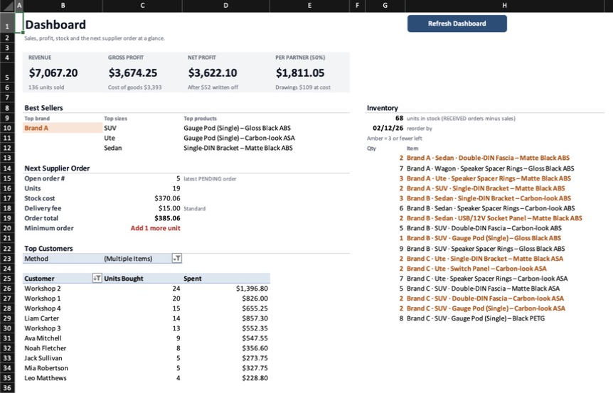
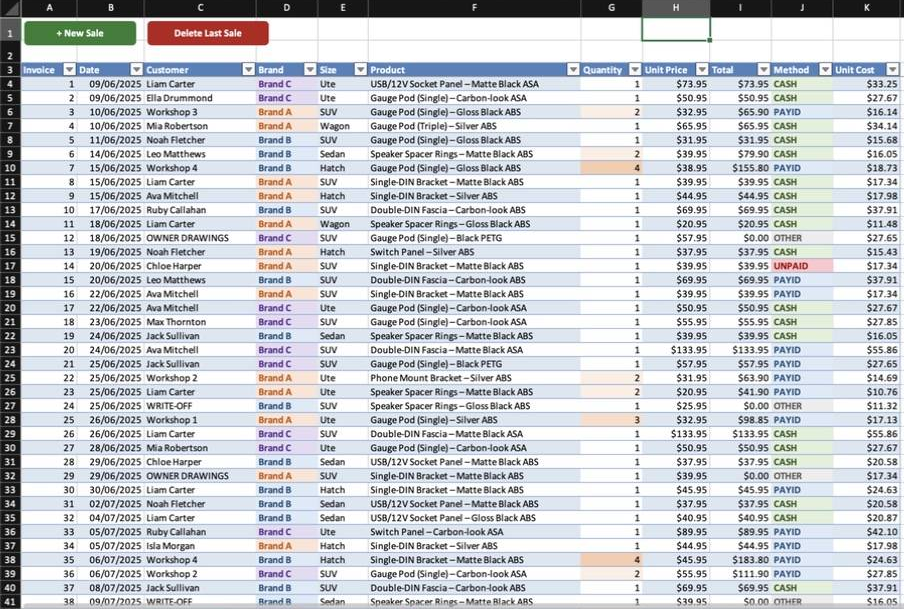
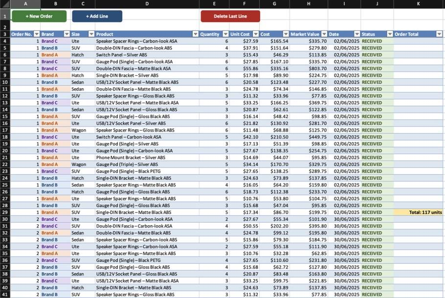
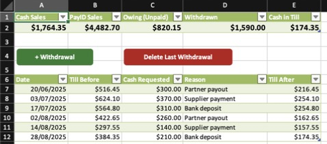
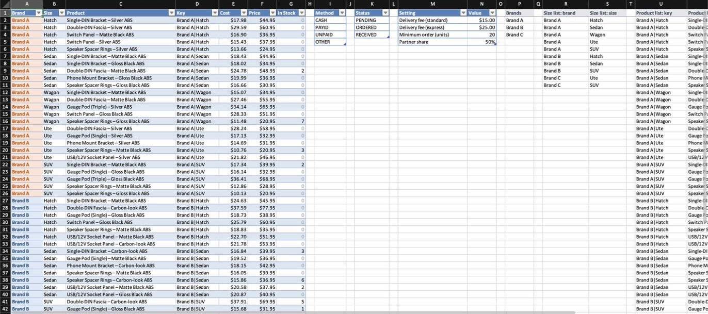

# Small Business Shopbook

**A small business run from one Excel workbook:** stock, supplier orders, sales, customers, cashflow, profit and a two-partner profit split. It's local-first and offline, with no server, subscription or database. The data never leaves the machine.

I hand-wrote the first version in mid-2025, without AI, for a small Perth retailer that ran one product line on its own books inside a bigger shop. It ran their day-to-day trading. In 2026 I reviewed it with fresh eyes, found seven real problems, and rebuilt it with AI as a pair programmer. This repo holds the result, along with the list of what was wrong and how it was fixed, plus a guide for building your own: [BUILD-WITH-AI.md](BUILD-WITH-AI.md).

> **All data in this workbook is synthetic.** The original product line is swapped for automotive dash and audio fit-out parts, the brands are redacted to *Brand A / B / C*, and every customer, sale and order is generated by [`tools/generate_data.py`](tools/generate_data.py) (seeded, so it's reproducible).

---

## Why a workbook?

A small shop with a few hundred transactions a quarter doesn't need a CRM, a database or an agent platform. It needs something the owners can open, read and fix themselves. One `.xlsm` file gives you:

- **Zero infrastructure.** Nothing to host, patch or pay for.
- **Full transparency.** Every number is a formula you can click on.
- **Offline by default.** The data stays on the owner's machine.
- **Easy backups.** Copy one file.

## What's inside

| Sheet | What it does |
|---|---|
| **Sales** | One row per sale line. Brand → Size → Product are dependent dropdowns; unit price and cost are stamped from the catalogue when you pick a product. Write-offs and owner drawings are recorded here too. |
| **Supplier Orders** | Multi-line orders grouped by order number, with automatic order totals. Status runs PENDING → ORDERED → RECEIVED, and only RECEIVED stock counts. |
| **Cashflow** | Till summary (cash, PayID, money owed) plus a withdrawals ledger with a running till balance. |
| **Dashboard** | Revenue, gross and net profit, the per-partner split, best sellers, the next supplier order with delivery fee and minimum-order check, a top-customers pivot and live stock levels. |
| **Catalogue** | The single source of truth: Brand → Size → Product, cost, price and live stock, plus settings (delivery fees, minimum order, partner share). |

<b>Screenshots of every sheet</b>

**Sales**

**Supplier Orders**

**Cashflow**

**Catalogue**

## How it works

- **Everything is an Excel table** (`tblSales`, `tblOrders`, `tblWithdrawals`, `tblCatalogue` …). Formulas use structured references, so nothing points at hard-coded ranges like `H4:H94`.
- **Three-level dependent dropdowns.** Spilled helper lists on the Catalogue (`UNIQUE`, `SORTBY`, `XMATCH`) feed the Size and Product dropdowns through `OFFSET`/`INDEX`/`MATCH`. Adding a product is a single new catalogue row.
- **Stock is a rule, not a macro:** `In Stock = RECEIVED order quantity − everything sold, written off or drawn`, per Brand | Size | Product.
- **Prices are frozen at the moment of sale.** A workbook event copies Unit Price and Unit Cost from the catalogue when a product is picked, so changing a price later never rewrites history.
- **Bookkeeping concepts are modelled properly.** *WRITE-OFF* (damaged stock) and *OWNER DRAWINGS* (stock taken for personal use) bring in no revenue, are valued at cost and are kept out of the customer rankings.
- **The macros only touch tables.** Every button goes through the `ListObject` API and finds columns by header name, so adding or moving a column can't break it.
- **The Dashboard is dynamic arrays** (`FILTER`, `SORTBY`, `UNIQUE`, `TAKE`, `LET`) plus one pivot for customers.

## Getting started

1. Download [`small-business-shopbook.xlsm`](small-business-shopbook.xlsm) and open it in **Microsoft 365 Excel** (Windows or Mac). The dashboard formulas (`TAKE`, `LET`, `XMATCH`) need 365.
2. Click **Enable Macros**.
3. Try it: **+ New Sale** on the Sales sheet, then pick Brand → Size → Product.
4. If the buttons or the customer pivot are ever missing, run the `SetupShopbook` macro (Tools → Macro → Macros…). It rebuilds them.

To make it your own, clear the sample rows from the tables, put your products in the Catalogue, and set your fees and partner share in **Catalogue → Settings**.

Regenerate the sample data with `python tools/generate_data.py`, which writes CSVs to `data/`.

## Licence

[MIT](LICENSE) © 2025–2026 Aaron Mark Kalaji
